<!-- Panels are hand-inked SVGs in src/, built to assets/ by scripts/build.py -->

  

  

  

  

  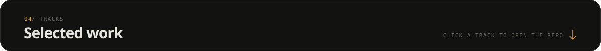

  <a href="https://github.com/Bookantna/phishMe"></a>

  <a href="https://github.com/Bookantna/Screenie"></a>
  <a href="https://github.com/Bookantna/Flower-Image-Colorization"></a>

  <a href="https://github.com/Bookantna/Multiprocessing"></a>
  <a href="https://github.com/Bookantna/ticketDorm"></a>

  <code>BONUS SHORTS</code>&nbsp;&nbsp;<a href="https://github.com/Bookantna/CSVSnap">CSVSnap</a> · <a href="https://github.com/Bookantna/chatbot">chatbot</a> · <a href="https://github.com/Bookantna/wifi-autologin">wifi-autologin</a> · <a href="https://github.com/Bookantna/free_reward">free_reward</a>

  <a href="https://www.linkedin.com/in/thanawatueasiripracha/">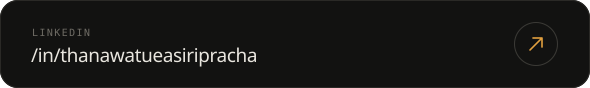</a>
  <a href="mailto:thanawatueasiripracha@gmail.com">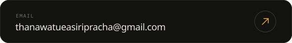</a>

  

